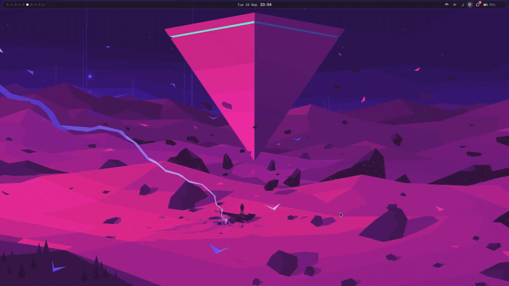

# PresTUI



PresTUI renders images in the terminal as ASCII, ANSI TrueColor, or Unicode half blocks. It includes an interactive terminal viewer.

## Install

### Linux (x86-64)

Download the compiled executable from the [v0.1.0 release](https://github.com/presvy1-beep/Prestui/releases/tag/v0.1.0):

```sh
curl -fLO https://github.com/presvy1-beep/Prestui/releases/download/v0.1.0/prestui-v0.1.0-linux-x86_64.tar.gz
curl -fLO https://github.com/presvy1-beep/Prestui/releases/download/v0.1.0/prestui-v0.1.0-linux-x86_64.tar.gz.sha256
sha256sum -c prestui-v0.1.0-linux-x86_64.tar.gz.sha256
tar -xzf prestui-v0.1.0-linux-x86_64.tar.gz
sudo install -Dm755 prestui-v0.1.0-linux-x86_64/prestui /usr/local/bin/prestui
```

The binary is built on Ubuntu 24.04 for x86-64 Linux and requires a compatible glibc-based system.

### From source

Requires Rust and Cargo:

```sh
cargo install --git https://github.com/presvy1-beep/Prestui --tag v0.1.0 --locked
```

## Usage

Open the interactive viewer or load an image directly:

```sh
prestui
prestui image.png
```

Render to the terminal or redirect the output:

```sh
prestui render image.png --mode ascii --width 80
prestui render image.png --mode ansi --width 100
prestui render image.png --mode blocks --width 100
prestui render image.png --mode ascii > image.txt
```

### Viewer controls

```text
1 / 2 / 3   ASCII / ANSI / Blocks
+ / -       Change preview width
i           Invert ASCII luminance
a           Toggle aspect correction
o           Open an image
s           Copy rendered output
?           Toggle help
q / Esc     Quit
```

Supports PNG, JPEG, WebP, BMP, and GIF. Use `prestui render --help` for all CLI options.

## Development

```sh
cargo fmt --all -- --check
cargo clippy --all-targets --all-features -- -D warnings
cargo test --locked
```

MIT licensed. See [LICENSE](LICENSE).
